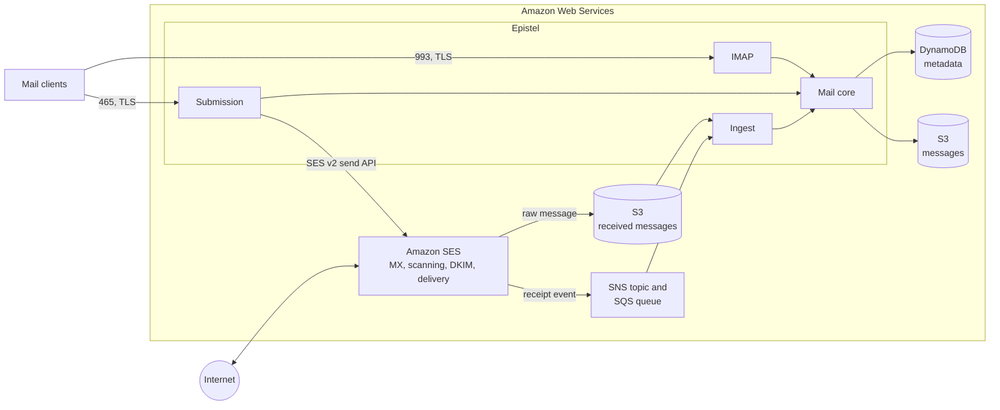

# Epistel

[](https://github.com/sigmastone-io/epistel/actions/workflows/ci.yml)

Epistel is a small open source mail server for domains whose mail is handled by a cloud mail
service. It keeps the mailboxes, serves them to ordinary mail clients (Outlook, Thunderbird, Apple
Mail, iOS and Android clients) over IMAP, and accepts outgoing mail over SMTP Submission, handing
it to the mail service for delivery. The first supported service is Amazon SES.

SES can receive and send mail for a domain, but it has no mailboxes and nothing a mail client can
connect to: received mail lands in a bucket. The usual workaround is forwarding everything to a
mailbox somewhere else, which moves the mail out of the account and breaks sender alignment on the
way. Epistel keeps the mail in the operator's own account instead.

> **Status: 0.1.0, the first release.** Mail comes in, can be read and managed, and goes out.
> Hardening comes next (see [What 0.1 covers](#what-01-covers)). There are no compatibility
> promises before 1.0: storage layout, configuration and command line may change between releases
> without a migration path.

## What it is, and what it is not

- **A mailbox server.** IMAP4rev1 on port 993 and SMTP Submission on port 465, both implicit TLS,
  for addresses of domains the mail service already receives for.
- **Not a mail transfer agent.** Epistel never listens on port 25 and never talks to other mail
  servers. Receiving from the internet, MX handling, delivery with retries, DKIM signing, and spam
  and virus scanning stay with the mail service. Mail arrives through SES and leaves through SES.
- **Stateless.** Messages live in an object store, everything else in a metadata store; the process
  keeps nothing on disk. On AWS that is S3 and DynamoDB. A replaced instance loses nothing.

## One protocol profile

There is exactly one way to connect, and no options to loosen it:

| | Port | Transport | Authentication |
|---|---|---|---|
| IMAP | 993 | implicit TLS | user name and app password |
| SMTP Submission | 465 | implicit TLS | user name and app password |

- No STARTTLS, no POP3, no plaintext listeners, no port 25.
- The user name is the mailbox's address. The password is an **app password**: generated by the
  server, shown once, stored only as an Argon2id hash. A mailbox can have one per device, each
  revocable on its own. There is no way to choose a password.
- Mechanisms: SASL `PLAIN`, IMAP `LOGIN`, and the `LOGIN` mechanism on Submission, all inside TLS.
  Challenge-response mechanisms that need a reversible secret on the server (CRAM-MD5,
  DIGEST-MD5, NTLM) are not offered.
- IMAP announces only what it implements: `IMAP4rev1 AUTH=PLAIN SASL-IR LITERAL+ ID ENABLE
  NAMESPACE UNSELECT SPECIAL-USE IDLE UIDPLUS MOVE`. Submission offers `AUTH PLAIN LOGIN`, `SIZE`,
  `8BITMIME`, `PIPELINING`, `ENHANCEDSTATUSCODES` and `SMTPUTF8`.

## How it works



- **Ingest.** SES stores each received message in S3 and publishes a receipt event (envelope
  recipients, spam, virus, SPF, DKIM and DMARC verdicts) through SNS to an SQS queue. Epistel reads
  the queue, resolves each recipient to a mailbox (exact address, then catch-all), stores the
  message once, and files it into `INBOX`, `Junk`, or a hidden quarantine by the service's verdicts.
  Filing is exactly once; a message that keeps failing goes to the dead-letter queue. Unknown
  recipients are dropped, never bounced, so there is no backscatter.
- **Submission.** An authenticated client may send only as addresses its mailbox owns, in the
  envelope and in `From`. The message goes to the SES v2 send API inside the SMTP transaction;
  there is no queue. A transient failure is answered with `451` and the client retries.
- **Vendor independence.** Storage, inbound, outbound and change notification sit behind traits in
  `epistel-core`. Every trait has an in-memory implementation and a conformance suite that every
  backend must pass, so other stores and mail services are additions, not rewrites.

The full design is in [doc/architecture.md](doc/architecture.md).

| Crate | Contents |
|---|---|
| `epistel-core` | domain types, backend traits, mail logic, in-memory backends, conformance suites |
| `epistel-imap` | IMAP server over any byte stream |
| `epistel-submission` | SMTP Submission server over any byte stream |
| `epistel-aws` | DynamoDB, S3, SES over SQS, and SES send backends |
| `epistel` | the binary: configuration, TLS listeners, administration commands |

## What 0.1 covers

The first release is the smallest thing that lets a mail client use a domain hosted on Amazon SES.
The scope is fixed in [doc/roadmap.md](doc/roadmap.md).

In 0.1:

- IMAP and Submission as above, with `IDLE` and changes visible between sessions.
- Metadata in DynamoDB, messages in S3, inbound from SES receipt events over SQS, outbound through
  the SES v2 send API.
- Accounts, app passwords, addresses, aliases and catch-all addresses (`*@example.org`), managed
  from the command line or declared in the configuration.
- Personal mailboxes with the standard special-use folders: `INBOX`, `Drafts`, `Sent`, `Junk`,
  `Trash`, `Archive`.
- Junk filing and virus quarantine from the mail service's verdicts.
- One instance, TLS certificate from files, reloaded when the files change.

Next, after 0.1.0 (hardening): rate limits for failed logins per source and per account,
connection limits per source and per account, graceful shutdown, fuzzing of the parsers, a manual
client matrix, the sweep for unreferenced stored messages, keeping the header block on the message
record, and release binaries for x86-64 and ARM64 Linux. The container image exists for x86-64
only.

Not in 0.1, by design: shared mailboxes, Sieve filters, quotas, `CONDSTORE`/`QRESYNC`, full-text
search, more than one instance, metrics, other backends. Never planned: POP3, STARTTLS, plaintext
listeners, port 25. The roadmap lists each with the reason.

## Running it

### What it needs

- A domain that Amazon SES already receives mail for, with a receipt rule that stores messages in
  S3 and notifies an SNS topic subscribed by an SQS queue, plus a DynamoDB table. The
  [Terraform module](#deploying-on-aws) makes all of this.
- A verified SES identity for every domain the server sends from.
- A certificate and key for the server's host name, as PEM files.
- AWS credentials from the environment, a profile, or the machine's role. They are never written
  into the configuration.

### Container image

The image holds one binary on a distroless base (no shell, no package manager) and runs it as an
unprivileged user, uid 65532. It publishes ports 993 and 465 and reads its configuration from
`/etc/epistel/epistel.toml`. Images are published to `ghcr.io/sigmastone-io/epistel`: each release
as its version (`0.1.0`) and minor line (`0.1`), and every build of `dev` as its commit. Deploy by
digest; each release's notes name it.

```
docker run -d --name epistel \
  -p 993:993 -p 465:465 \
  -v /etc/epistel:/etc/epistel:ro \
  ghcr.io/sigmastone-io/epistel@sha256:<digest>
```

The configuration, certificate and key must be readable by uid 65532. Or build the image yourself:
`docker build -t epistel .`

### Configuration

One TOML file. [epistel.example.toml](epistel.example.toml) shows every key; each backend section
picks its implementation with `backend`, and `memory` keeps everything in the process for trying
things out. For AWS:

```toml
[server]
hostname = "mail.example.org"

[tls]
certificate = "/etc/epistel/tls/fullchain.pem"
private_key = "/etc/epistel/tls/key.pem"

[metadata]
backend = "dynamodb"
table = "epistel"

[blobs]
backend = "s3"
bucket = "example-epistel-mail"

[inbound]
backend = "ses-sqs"
queue_url = "https://sqs.eu-west-1.amazonaws.com/123456789012/epistel-inbound"

[outbound]
backend = "ses"

[[mailbox]]
address = "ada@example.org"
name = "Ada"
aliases = ["sales@example.org"]
```

`epistel check` reads the configuration, reports what it selects, and exits. `epistel serve` runs
ingest, IMAP and Submission until stopped. Logs are lines on a terminal and JSON otherwise.

### Mailboxes and passwords

Mailboxes declared with `[[mailbox]]` are made at startup when missing, with their folders and
aliases. The server never changes or removes one; a mailbox dropped from the list stays, with its
mail, until removed by hand. Mailboxes can also be managed by command:

```
epistel account add ada@example.org --name "Ada"
epistel address add sales@example.org ada@example.org
epistel address add '*@example.org' ada@example.org
epistel password new ada@example.org --label laptop
epistel password list ada@example.org
epistel password revoke ada@example.org <id>
```

Passwords never appear in the configuration: `epistel password new` prints one, once. The commands
need the same configuration and cloud identity as the server; in a container, run them with
`docker exec epistel epistel ...`. `epistel help` lists the rest.

### Client setup

| Setting | Value |
|---|---|
| Incoming server | IMAP, the host name, port 993, SSL/TLS |
| Outgoing server | SMTP, the host name, port 465, SSL/TLS |
| User name | the mailbox's address, for example `ada@example.org` |
| Password | an app password from `epistel password new` |
| Authentication | normal password |

Use the same user name and password for incoming and outgoing mail. Aliases deliver into the
mailbox and may be used as the sender. The copy in `Sent` is made by the client, as with any IMAP
server.

### Bringing in older mail

A domain that received mail through an SES receipt rule with an S3 action before Epistel was set
up still has those messages in that bucket. [tools/import_from_s3.py](tools/import_from_s3.py)
reads them and appends each over IMAP to the mailbox of the address it was sent to, with the date
it arrived. It needs Python, the AWS CLI and the mailboxes' app passwords, changes nothing in the
bucket, and is safe to run again. Without `--apply` it only reports what it would do.

```
python tools/import_from_s3.py --bucket my-mail-bucket --prefix inbound/ \
  --host mail.example.org --passwords passwords.txt
```

## Deploying on AWS

[terraform-aws-epistel](https://github.com/sigmastone-io/terraform-aws-epistel) is the matching
Terraform module: it adds a receipt rule to an existing SES rule set and makes the topic, queues,
bucket, table and one EC2 instance running this image, with a certificate from Let's Encrypt. Its
default shape costs about 14 USD a month.

## Building from source

Rust 1.85 or newer. The TLS library under the AWS SDK builds C code, so a C compiler and CMake are
needed as well.

```
cargo build --release -p epistel
cargo test --workspace --all-features
cargo run -p epistel -- --config epistel.example.toml check
```

The AWS backends run their conformance suites against emulators when
`EPISTEL_TEST_DYNAMODB_ENDPOINT`, `EPISTEL_TEST_S3_ENDPOINT` and `EPISTEL_TEST_SQS_ENDPOINT` name
one (CI uses DynamoDB Local, S3Mock and ElasticMQ), and report themselves skipped otherwise. See
[crates/epistel-aws/tests/emulators.rs](crates/epistel-aws/tests/emulators.rs).

## Security

- Only TLS listeners exist; there is no way to configure a plaintext one.
- App passwords only, stored as Argon2id hashes. Every failed login is answered after a fixed delay.
  Each listener serves at most 2048 connections at a time. Per-source and per-account rate limits
  and connection limits come with hardening and are not in 0.1.0; until then, restrict who can
  reach the ports where you can.
- No credentials in the configuration. Cloud access uses the identity of the host.
- Message content and credentials are never logged. Logs carry connection, account and message
  identifiers only.
- Encryption at rest is the storage backend's job; the Terraform module turns it on.
- The process runs unprivileged and needs nothing beyond binding its two ports.

Please report vulnerabilities privately through GitHub's private vulnerability reporting on this
repository (Security, then Report a vulnerability), not in a public issue.

## Contributing

Issues and pull requests are welcome. Open an issue before a larger change: the scope of 0.1 is
fixed, and anything under "Not in 0.1" in the roadmap starts with a change to the roadmap. CI runs
`cargo fmt --check`, `cargo clippy -- -D warnings` and the tests, including the backends against
emulators; please run them before sending a pull request. Contributions are accepted under the
Apache License 2.0.

## Licence

Licensed under the [Apache License 2.0](LICENSE). See [NOTICE](NOTICE).

---

Epistel is made by [Sigmastone](https://sigmastone.io). © 2026 Sigmastone OÜ.
